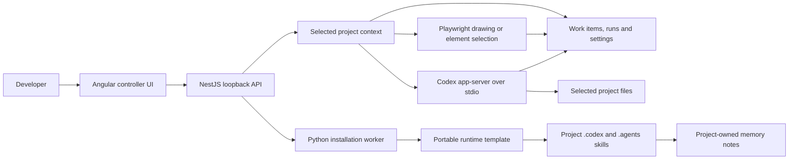
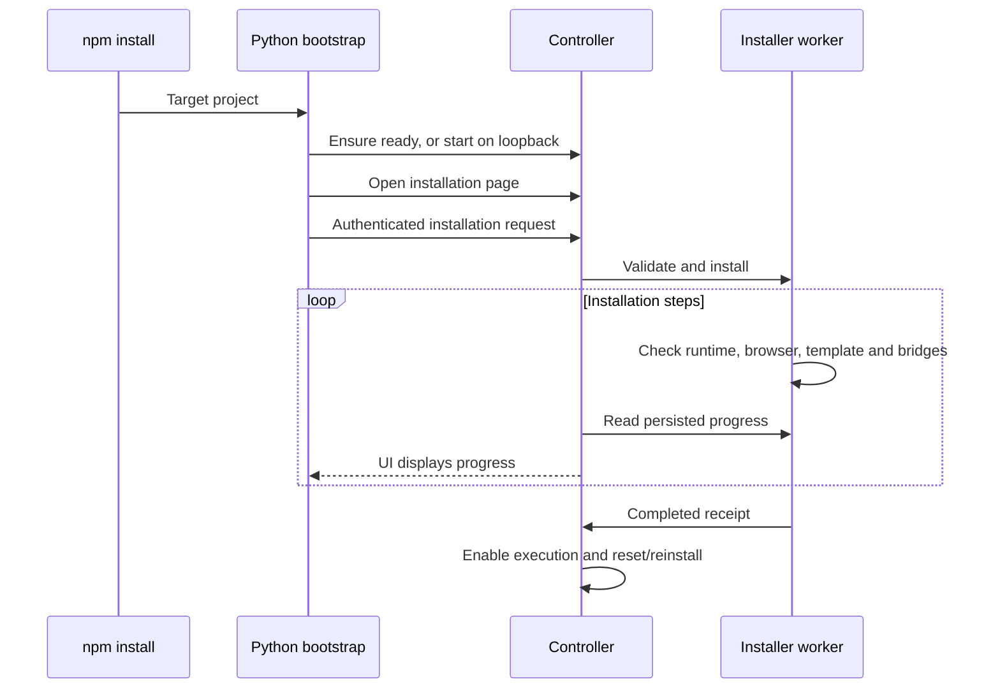

# RUNTIME CONTROLLER

[System architecture](#system-architecture) · [Installation](#installation)

A local Angular + NestJS development plugin. Draw a layout or select an element in a running local app, save instructions, and execute selected work items with Codex in the selected project.

## System architecture



The API serves the compiled UI and owns one selected project at a time. Switching folders loads that project's work items, history, settings and installation state, closes owned browsers, and rotates the mutation token. Active execution or installation blocks switching. Stale browser tabs must reload the current project before writing.

| Page | Route | Purpose |
| --- | --- | --- |
| Agent Runtime | `/controller/agent-runtime` | Pending work, capture and execution |
| Work Docs | `/controller/work-docs` | Search and read project Markdown plans and documentation |
| Run History | `/controller/history` | Completed work items and agent runs |
| Work Docs | `/controller/work-docs` | Project Markdown with page scrolling |
| Settings | `/controller/settings` | Selected-project execution settings |
| Observability | `/controller/observability` | Health, logs and recorded token usage |
| Installation | `/controller/install` | Progress, retry, reinstall and reset |
| Drawing canvas | `/controller/canvas` | Rectangle instructions |

**Settings** contains **Select project** and the **Runtime installed / Runtime setup** entry. Work Docs uses a wider desktop file list and lets long documents scroll with the page.

**Add interactive work items** opens a choice between a blank drawing canvas and an existing local URL. Draw a rectangle or highlight an element, describe the change, and save. Select pending items and confirm execution. Completed items move to Run History; unresolved work remains visible separately. A completed Codex turn is not a guarantee that its code is correct: review the output and validation.

Project records live in `.codex/visual-builder/`; installer receipts, progress, project registry and memory live in `.codex/runtime-controller/`. The packaged template contains reusable instructions, five role definitions, five skills, workflows, activity logging, UI-testing helpers and a memory CLI. It deliberately excludes GB Systems credentials, account configuration, private memories, sessions, caches, domain-specific projects and installed third-party plugins. See [template provenance](runtime-template/README.md) and [installer architecture](installer/ARCHITECTURE.md).

## Installation

### Requirements

- macOS or Linux; Python **3.11+**, Node **22.13+** and npm.
- An installed and authenticated `codex` CLI for execution. Installation can finish without authentication; **CLI available** only reports executable availability.
- A desktop session for visible capture browsers. The installer checks Chromium and downloads it through Playwright when missing; first setup may need internet access.
- Windows is not supported by the Python installer in this release.

### Clone, build and run

```bash
git clone https://github.com/gopalcb/agent-runtime-controller.git
cd agent-runtime-controller
npm ci
npm --prefix frontend ci
npm run build
npm run setup -- --project "$PWD"
```

The source checkout's npm lifecycle prints setup instructions rather than launching an unbuilt app. `setup` starts the controller, opens `/controller/install`, and submits installation. The page shows actual step status and progress. The unprivileged default is **http://127.0.0.1:10101/controller/install**. For a different port:

```bash
npm run setup -- --project /absolute/path/to/project --port 10102
```

### Install the plugin in another project

Build a distributable from this checkout:

```bash
npm pack
```

Then run from the target project's directory:

```bash
npm pkg set "overrides.multer=2.5.0"
npm install --save-dev /absolute/path/to/gb-systems-visual-agent-builder-0.2.0.tgz
```

The explicit override is currently necessary because NestJS pins an older Multer version and npm does not inherit a dependency package's overrides. Preserve any other existing overrides. Version 2.5.0 fixes the [upstream Multer advisory](https://github.com/advisories/GHSA-q7qp-rjg7-q26m).

The npm postinstall starts the Python bootstrap against the installation directory. It starts or finds the controller, opens the installation page, and begins setup for that active project. If a different project is already active, it registers the new folder without switching it: select the new folder in the controller to install. Installation runs asynchronously; wait for **Installation complete** before executing work.

If your package manager disables lifecycle scripts, or setup reports a prerequisite error, run:

```bash
npx runtime-controller setup --project "$PWD"
```

For unattended installation set `RUNTIME_CONTROLLER_NO_OPEN=1`; set `RUNTIME_CONTROLLER_PORT` to choose the lifecycle bootstrap port. `RUNTIME_CONTROLLER_SKIP_SETUP=1` deliberately skips automatic setup. These flags do not mark an unfinished installation complete.



### Requested hostname: localhost.runtime-controller:1001

On systems that permit it, start with `npx runtime-controller --project "$PWD" --port 1001` and configure the hostname to resolve to loopback. This Mac rejects unprivileged port 1001 and does not resolve the hostname automatically. The supported helper keeps the controller unprivileged on port 10101 and forwards the requested address:

```bash
# First start setup/controller on 10101 as your normal user.
# From the cloned Runtime Controller repository, in a separate terminal:
sudo python3 -m installer.host_setup
```

For an installed npm plugin, run the helper from `node_modules/@gb-systems/visual-agent-builder`. It checks the running controller, adds the exact loopback alias to `/etc/hosts` with a backup, binds port 1001, then drops privileges before accepting connections. Keep the helper running in that terminal. It is not a persistent system service; stopping it stops forwarding. Never run the Node controller or Codex as root.

The resulting address is **http://localhost.runtime-controller:1001/controller/agent-runtime**. Without administrator setup, use **http://127.0.0.1:10101**. A plain `npm start` tries 1001 and falls back to 10101 on permission failure; an explicit `--port 1001` reports failure instead of silently changing ports.

### Start the controller when starting Codex

After setup, launch Codex through the installed project entry point:

```bash
python3 /absolute/path/to/project/.codex/runtime-controller/codex.py
```

This checks controller identity and readiness, starts it only when needed, then launches Codex in that project and forwards CLI arguments. It preserves the existing native `CODEX_HOME` and authentication environment. Portable project tools use `RUNTIME_CONTROLLER_CODEX_HOME` instead. An already-active different project is registered, never silently switched.

This is an explicit project launcher, not an automatically registered IDE/native Codex startup hook. Direct `codex` or IDE launches do not invoke it. Use this wrapper in your terminal/project launch configuration. The privileged port-forward helper must still be running if you want port 1001.

### Existing files, memory and maintenance

Installation creates `.codex` runtime files and discoverable `.agents/skills` copies. An existing root `AGENTS.md` is preserved; when installation reports a bridge conflict, add a reference to the project's `.codex/AGENTS.md` manually. Role definitions are portable templates, not a promise that a Codex client auto-registers them or supports every model.

After successful installation, **Reinstall** updates unchanged managed files and preserves user edits as conflicts for review. **Reset managed runtime** removes only unchanged managed files; work items, history, settings, user-edited files and memory remain. Retry is available after failure. Interrupted installs are reported instead of being treated as successful. Review conflict details under `.codex/runtime-controller/conflicts/`.

Memory is explicit, project-owned retention rather than a copy of private native Codex memory:

```bash
python3 .codex/tools/project_memory/memory.py --project "$PWD" add 'Run npm test before submitting changes.'
python3 .codex/tools/project_memory/memory.py --project "$PWD" search "npm test"
python3 .codex/tools/project_memory/memory.py --project "$PWD" list
```

Only add information the user asked to retain; do not store secrets. The CLI stores notes atomically under `.codex/runtime-controller/memory/` and does not alter native memory databases. See [memory tool usage](runtime-template/.codex/tools/project_memory/README.md).

## Local boundaries

This is a trusted local development tool, not a hosted multi-user service. The API binds loopback, checks Host/Origin, and requires a rotating token for mutations. Defaults are workspace-write, network disabled for commands and approval policy `never`. Settings can grant broader access; full access can modify files outside the project. Command/file approvals supported by the adapter appear in the UI; unsupported interaction requests are rejected. Authentication remains environment-owned. The adapter disables inherited MCP/plugin/browser/hook integrations for controller-owned agent execution and verifies effective settings before starting a thread.

Capture browsers use separate profiles, do not import browser logins, allow only local URLs and same-origin navigation, and omit form values and URL query/hash from captured evidence. Ordinary visible page text is included. Closed shadow roots and cross-origin frames cannot be selected. Close capture windows when finished; server shutdown and project switching close its owned browsers. Test automation uses `finally` cleanup and must preserve regular user browsers.

One process owns a project at a time. Interrupted runs are not replayed automatically. If a crash leaves `.codex/visual-builder/owner.lock`, verify the recorded process is dead before removing that project's lock. Cancellation does not undo partial code edits.

Recorded tokens persist per run/thread and deduplicate cumulative reports. Missing reports show **Unreported**; totals are recorded plugin usage, not account billing.

## Development and release checks

Backend source uses consistent formatting and separated workflow steps. Run `npm run format:backend` to format it and `npm run format:backend:check` to verify it. See [backend responsibilities](docs/architecture.md) before structural changes.

```bash
npm test
npm run test:installer
npm run build
npm run test:ui
node tests/controller.smoke.cjs
python3 scripts/export-runtime-template.py --check
npm audit --omit=dev
npm --prefix frontend audit
npm pack --dry-run
```

Backend tests use disposable projects, real installer workers and synthetic Codex transports. Browser checks cover desktop/mobile layouts, drawing, history, settings, URL validation and real installation/project switching. They do not prove a real model turn or native Computer Use stability. Production builds use locally bundled [Bootstrap Icons](https://icons.getbootstrap.com/); no icon CDN is needed.

For frontend development, start the API explicitly on port 4310 (`npm start -- --port 4310 --no-open`) and run `npm --prefix frontend start` on 4311. Production serves Angular assets from NestJS.

The Git ignore file excludes dependencies, build output, archives, local `.codex`/`.agents` state, secrets and test artifacts. The portable `runtime-template/.codex` is intentionally tracked. Inspect staged files before the first commit. This repository is marked **UNLICENSED**; choose distribution terms before publishing. Third-party notices are in [THIRD_PARTY_NOTICES.md](THIRD_PARTY_NOTICES.md).

Work Docs lists Markdown at the project root and under `docs/`, `plans/`, `.codex/tasks/`, and `.codex/plans/`, newest first. Refresh to discover files created during a run. Files have no agent-author attribution. The reader formats common Markdown and treats embedded HTML as text. Discovery excludes symlinks, dependency folders and other hidden directories, caps traversal at 5,000 entries/depth 8 and the list at 500 documents; files over 512 KiB are excluded.

Active execution appears above Work Items in a fixed-height terminal. New output arrives at the bottom and auto-scrolls; pause auto-scroll to read earlier output. Finished output remains in Run History. Project selection and runtime setup are available from page actions.
