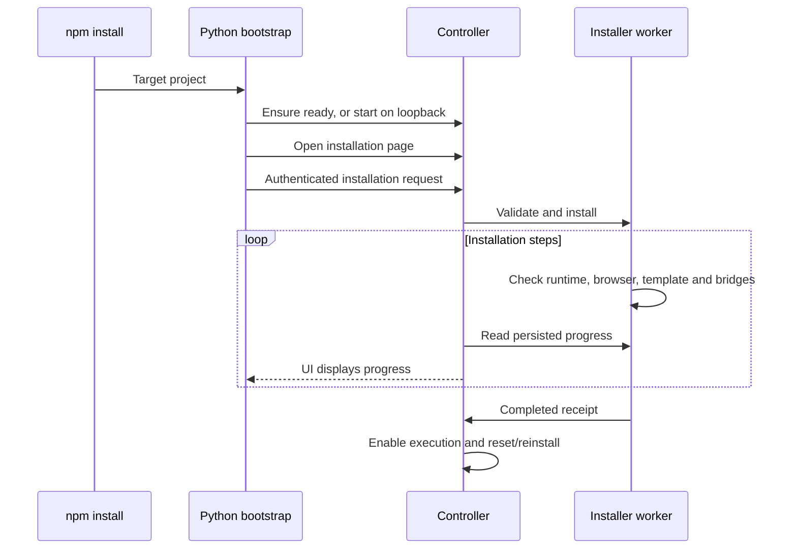

# RUNTIME CONTROLLER

[Portfolio article](https://gopalcb.github.io/#/projects/visual-agent-builder) · [Installation](#installation)

## USING RUNTIME CONTROLLER TO IMPROVE ITSELF

[Watch the demo (MP4)](https://gopalcb.github.io/projects/assets/visual-agent-builder/runtime-controller-demo.mp4)

See how I use Runtime Controller to guide changes to its own interface. [Open the video in a new tab](https://gopalcb.github.io/projects/assets/visual-agent-builder/runtime-controller-demo.mp4).

## WHAT I BUILT, AND WHY

My work started with building a local system with a UI to organize documents generated by agents for my learning: implementation details, code snippets and reusable functions. I wanted to find useful documents, choose what to keep as agent memory, and reference the right document in a prompt.

While building it, I found that prompt automation could guide agents more clearly and automate repeated work. Visual instructions made requests more precise: pointing directly at the part of an application that needed changing often reduced the effort of explaining the task. This grew into Runtime Controller, which I now use to guide and review improvements to the controller itself.

## THE ARCHITECTURE, FROM THE DEVELOPER’S POINT OF VIEW

Think of the NestJS process as the coordinator for one selected project. The UI asks it to capture a visual reference, save an instruction or run the work. It keeps the project’s saved state, agent runtime, capture browsers and installation worker together in one session. When you switch projects, it closes the old session and opens one for the new project.

### FROM VISUAL INTENT TO A SAVED RESULT

Follow the solid arrows from your visual instruction to the saved result. The branches show where the controller saves progress and where Codex edits the application files. The UI reads the saved state to show what happened. You then review the changes and check that they work as intended.



Completed means the Codex turn finished; it does not independently prove the code is correct. Source: backend/runtime.ts, backend/store.ts and frontend/src/app.ts. [View Mermaid source](docs/article/request-to-result.mmd).

Production serves the compiled Angular application from NestJS. During development, the documented API port is `4310` and the frontend port is `4311`. The controller normally runs on the unprivileged loopback address `127.0.0.1:10101`. A separate, optional host helper provides the custom hostname and port described in the repository README.

| Component | Responsibility | Useful source entry point |
| --- | --- | --- |
| Angular application | Selection, drafts, confirmation, polling, terminal view and history. | `frontend/src/app.ts`, `app.html` |
| HTTP boundary | Routes, Host/Origin checks, mutation token and project identity checks. | `backend/routing.ts` |
| Project session | Switching, token rotation and cleanup of the old project’s resources. | `backend/projects.ts` |
| Persistence | Ownership lock, input validation, state and bounded activity history. | `backend/store.ts`, `state-file.ts` |
| Agent runtime | Run snapshots, prompt assembly, lifecycle, approvals and usage. | `backend/runtime.ts` |
| Codex transport | Subprocess ownership, line-delimited RPC, correlation and disconnect handling. | `backend/codex.ts` |
| Visual capture | Drawing window, local-page overlay and bounded element evidence. | `backend/browser.ts`, `live-browser.ts`, `reference.ts` |
| Installation and documents | Python worker lifecycle; bounded project Markdown discovery and reading. | `backend/installation.ts`, `installer/`, `backend/documents.ts` |

## 1. GIVE THE CHANGE A PRECISE VISUAL REFERENCE

There are two ways to begin. A blank canvas is useful when the layout does not exist yet: draw a rectangle, give it a title and explain what belongs there. An existing local application is useful when something already needs fixing: open its URL in the controlled browser and select the relevant element.

Both paths produce an `Instruction`. The rectangle is recorded in CSS pixels with the viewport width and height. These numbers describe the original visual intent; the prompt tells Codex to implement a responsive layout instead of treating every measurement as a universal fixed size.

### SAVING A CANVAS INSTRUCTION

The following request uses illustrative values. The server supplies the ID, timestamp and initial `todo` status; the client does not choose them.

*HTTP / JSON*

```http
POST /api/instructions
Content-Type: application/json
X-Builder-Token: <current bootstrap token>
X-Project-Id: <selected project id>

{
  "title": "Make the sidebar easier to scan",
  "description": "Group project actions and keep the layout usable on narrow screens.",
  "rect": { "x": 24, "y": 96, "width": 280, "height": 600 },
  "viewport": { "width": 1440, "height": 900 }
}
```

Validation requires a nonblank title and description, limits them to 160 and 12,000 characters, and checks that the rectangle is finite, at least 8 × 8 pixels and inside the viewport. The store adds the instruction and records the change in the same persisted state.

### WHAT AN EXISTING-ELEMENT REFERENCE ADDS

A live capture attaches a `source` object. Here is the shape with shortened, illustrative page content:

*JSON*

```json
{
  "kind": "element",
  "url": "http://localhost:4200/dashboard",
  "selector": "#project-sidebar",
  "tag": "aside",
  "text": "Projects Settings",
  "html": "<aside id=\"project-sidebar\">Projects Settings</aside>",
  "styles": { "display": "flex", "gap": "12px", "padding": "16px" },
  "scroll": { "x": 0, "y": 120 }
}
```

The controlled browser uses its own profile, accepts local target URLs and blocks top-level navigation away from the opened app’s origin. This does not block every external subresource or subframe request. The capture path omits form values and removes query strings and fragments from saved URLs. The server bounds the selector, text, HTML and supported style values; ordinary visible text can still contain sensitive information, so capture only the relevant page.

A selector is a clue to the rendered element, not a guaranteed source-file location. Codex still has to inspect the application and map the evidence back to its components. Closed shadow roots and cross-origin frames are outside this selection flow. Captured HTML and text are explicitly treated as untrusted evidence in the developer instructions.

Source: `backend/store.ts`, `backend/reference.ts` and `backend/live-browser.ts`.

## 2. TURN SELECTED WORK INTO AN EXECUTION SNAPSHOT

The developer selects pending items and confirms execution. Angular sends their IDs and any additional context. Installation must be complete first, and an active run prevents a second dispatch.

*HTTP / JSON*

```http
POST /api/execute
Content-Type: application/json
X-Builder-Token: <current bootstrap token>
X-Project-Id: <selected project id>

{
  "instructionIds": ["instruction-example-1"],
  "prompt": "Follow the existing spacing and typography. Verify mobile layout."
}
```

`Runtime.execute()` checks that the selected IDs are distinct and refer to saved `todo` items. The API can also execute all pending items when `instructionIds` is omitted. It preserves the saved order and copies the selected instructions and settings into a new run. Later settings changes therefore affect future runs, not the request already in flight.

*TypeScript · excerpt from backend/runtime.ts*

```typescript
const run: Run = {
  id: randomUUID(),
  status: 'starting',
  settings: Object.freeze(structuredClone(this.store.state.settings)),
  instructionIds: instructions.map((item) => item.id),
  instructions: structuredClone(instructions),
  createdAt: new Date().toISOString(),
  prompt: value?.prompt || '',
  output: '',
};
for (const item of instructions) item.status = 'running';
this.store.state.runs.unshift(run);
this.store.event('run.queued', `Queued ${instructions.length} visual instruction(s)`, run.id);
```

The run is saved before asynchronous dispatch begins. The HTTP response is the run record, not a final coding result. The browser subsequently follows its status through state polling.

### PROTECTING THE SELECTED PROJECT

`GET /api/bootstrap` supplies initial state and the current mutation token. Mutations send that token in `X-Builder-Token` and the selected identity in `X-Project-Id`. Host, Origin and cross-site request checks run before route dispatch. Switching projects rotates the token, closes the old session’s resources, and returns a new bootstrap response. Active execution or installation prevents switching.

Angular also clears project-specific drafts and rejects results from obsolete project epochs. This matters when a slow request finishes after a switch: it must not put the previous project’s data into the new project’s screen.

## 3. START CODEX AND SEND THE ACTUAL TASK

The browser never launches Codex directly. The backend creates a `CodexTransport` bound to the selected project. It starts `codex app-server --listen stdio://` with explicit configuration overrides and the project as its working directory. Native authentication stays in the environment; the controller does not copy credentials into project state.

From a local process to one model turn

1. **Initialize and inspect**Start app-server, send initialize / initialized, then config/read. Discover inherited integrations.
2. **Restart and verify**Disable inherited MCP/plugins and supported integration features. Read effective configuration again; fail if isolation cannot be verified.
3. **Create thread and turn**thread/start supplies policy and developer instructions. turn/start supplies the saved work and additional user context.

Each run starts a fresh thread. This adapter does not resume a previous conversation or fetch history with thread/read.

Transport messages are newline-delimited JSON. Each outgoing request gets an ID and a pending promise with a timeout. Responses resolve or reject that promise by ID. Notifications go to the runtime; supported incoming approval requests take a separate request/response path. The transport does not automatically retry a potentially side-effecting request.

### THE THREAD SETS THE WORKING BOUNDARY

The following is an abbreviated request shape, with an illustrative project path. The implementation also sets explicit network and temporary-directory options. A model is included only when the project settings specify one.

*JSON · abbreviated RPC envelope*

```json
{
  "id": "rpc-example-1",
  "method": "thread/start",
  "params": {
    "cwd": "/workspace/example-app",
    "approvalPolicy": "never",
    "approvalsReviewer": "user",
    "sandbox": "workspace-write",
    "config": {
      "sandbox_workspace_write.network_access": false,
      "sandbox_read_only.network_access": false,
      "sandbox_workspace_write.writable_roots": [],
      "sandbox_workspace_write.exclude_tmpdir_env_var": true,
      "sandbox_workspace_write.exclude_slash_tmp": true
    },
    "developerInstructions": "[project-scoped instructions; abbreviated here]"
  }
}
```

The full developer instructions tell the agent to follow the project’s `AGENTS.md` and `.codex/visual-builder/AGENTS.md`, preserve unrelated changes, interpret visual references responsively, verify relevant behavior, and report actual checks and blockers. They also tell it not to edit the controller’s state file or ownership lock.

### THE TURN CARRIES THE WORK

This source excerpt shows where UI data becomes the model input. The saved instruction snapshot is serialized into the prompt; the original HTTP payload is not forwarded unchanged.

*TypeScript · excerpt from backend/runtime.ts*

```typescript
const prompt = [
  'Implement these saved visual instructions in this project.',
  `Project: ${this.store.root}`,
  `Additional user context: ${run.prompt}`,
  'Visual instructions (CSS pixels with viewport reference):',
  JSON.stringify(run.instructions, null, 2),
].join('\n');
const result = await transport.request('turn/start', {
  ...requestSettings,
  threadId: run.threadId,
  input: [{ type: 'text', text: prompt }],
  sandboxPolicy: sandboxPolicy(settings, this.store.root),
  ...(settings.reasoningEffort ? { effort: settings.reasoningEffort } : {}),
});
run.turnId = result.turn.id;
this.store.save();
```

The `thread/start` response supplies `thread.id`; `turn/start` supplies `turn.id`. These connect later notifications to the run. The model input contains text and serialized evidence, with no screenshot attachment. There is no required JSON output schema for the agent’s final explanation. Coding happens through Codex’s own workspace operations, while the controller receives lifecycle messages and agent text.

Source: `backend/codex.ts`, `backend/runtime.ts` and `backend/settings.ts`. This describes the repository adapter, not a guarantee that every installed Codex version supports its assumptions.

## 4. PROCESS THE RESULT WITHOUT CONFUSING “FINISHED” WITH “VERIFIED”

Once a run owns a thread, the runtime ignores ordinary notices from other thread IDs. It handles completed agent messages, item lifecycle events, usage reports and the terminal turn status. An illustrative completed message looks like this:

*JSON · illustrative notification*

```json
{
  "method": "item/completed",
  "params": {
    "threadId": "thread-example-1",
    "item": {
      "type": "agentMessage",
      "text": "Updated the sidebar. Build passed; browser verification was not run."
    }
  }
}
```

The text above demonstrates the data shape; it is not a test result from this review. The runtime appends message text to `run.output` and keeps its last 60,000 characters:

*TypeScript · excerpt from backend/runtime.ts*

```typescript
if (method === 'item/completed' && params.item?.type === 'agentMessage') {
  run.output = (run.output + params.item.text + '\n').slice(-60000);
  this.store.save();
}
```

| Incoming event | Controller action |
| --- | --- |
| `turn/started` | Save the turn ID. |
| `item/started`, `item/completed` | Save a short activity description such as “commandExecution completed”; completed agent messages also update output. |
| `thread/tokenUsage/updated` | Validate cumulative totals and retain the greatest total for the run. |
| `turn/completed` | Map completed to completed, interrupted to cancelled, and other endings to failed. Save finish time and any error. |
| `error` | Record a runtime error event. This alone is not treated as terminal completion. |
| Unexpected subprocess disconnect | Mark an active run interrupted; the execution outcome may be unknown. |

Finishing a successful turn marks the selected instructions completed. Other terminal outcomes mark those instructions failed. The UI can now separate completed work from unresolved work. This is a lifecycle decision, not a code-review verdict: the controller does not independently parse test evidence, approve a diff, or prove that the requested UI is correct.

The terminal panel displays saved agent output, or activity summaries while there is no output. It updates through HTTP polling, not WebSockets or token-by-token streaming. Text deltas, full tool stdout, generated diffs and command transcripts are not persisted by this adapter.

## 5. SAVE THE RECORD, THEN READ IT BACK

There are two kinds of output to keep separate. The changed application files live in the selected project. The controller’s record of the work lives under that project’s `.codex` directory. Refreshing the UI reads that record; it does not ask the model to reconstruct what happened.

*Project-relative paths*

```
.codex/
  visual-builder/
    state.json          # Settings, instructions, run snapshots and activity
    owner.lock          # Process ID and unique ownership ID
    AGENTS.md           # Guidance for controller-owned work
  runtime-controller/
    ...                 # Installer state, receipt, conflicts and project registry
    memory/             # Explicit project-owned retained notes
```

### THE PERSISTED DATA MODEL

These are the central fields from `backend/types.ts`, compacted for reading. Optional fields appear as the run progresses.

*TypeScript · condensed source contracts*

```typescript
type Instruction = {
  id: string;
  title: string;
  description: string;
  rect: { x: number; y: number; width: number; height: number };
  viewport: { width: number; height: number };
  source?: ElementSource;
  status: 'todo' | 'running' | 'completed' | 'failed';
  createdAt: string;
};

type Run = {
  id: string;
  status: 'starting' | 'running' | 'completed' | 'failed'
        | 'interrupted' | 'cancelled';
  instructionIds: string[];
  instructions: Instruction[]; // Snapshot at dispatch, not live instruction state
  settings?: Settings;
  prompt: string;             // Additional user context, not the assembled prompt
  output: string;
  threadId?: string;
  turnId?: string;
  tokenUsage?: TokenUsage;
  createdAt: string;
  finishedAt?: string;
  error?: string;
};

type Activity = {
  id: string; time: string; type: string; message: string; runId?: string;
};

type State = {
  version: 1;
  settings: Settings;
  instructions: Instruction[];
  runs: Run[];
  events: Activity[];
};
```

The copy in `run.instructions` preserves what was selected at dispatch, including its then-current status. The main `state.instructions` array carries the current work-item status. `run.prompt` stores the additional user context; the complete model prompt is assembled from that context, the project path and the snapshot.

### ATOMIC REPLACEMENT, WITH ONE PROCESS OWNING THE PROJECT

`ProjectStore` canonicalizes the root, checks state paths, and exclusively creates an `owner.lock`. It rejects unsafe state files and refuses a second owner. Each save writes formatted JSON to a uniquely named temporary file, closes it, and renames it over `state.json`. Failed temporary writes are cleaned up. This avoids exposing a partially written JSON file; it is not a database transaction log or a backup system, and there is no explicit fsync-based power-loss guarantee.

On startup, saved runs left in `starting` or `running` become `interrupted`, with a message to inspect project changes before retrying. A stale ownership lock requires checking that the former process is dead before removal. The application does not silently replay the task.

### RETRIEVAL IS A LOCAL STATE READ

The API builds `GET /api/state` from the active session. It returns project identity, registered projects, instructions, runs, events, settings, pending approvals, installation status, controller identity, health, runtime status and browser-open flags. The mutation token is returned by bootstrap, not each state response.

Angular refreshes every two seconds. History and Observability are views of these returned records, rather than separate database queries. There is no paginated run-history endpoint in this implementation. Events and output are bounded, but run and instruction collections can continue growing, which makes full-state polling and whole-file saves a practical scaling limit.

Source: `backend/store.ts`, `backend/state-file.ts`, `backend/types.ts`, `backend/routing.ts` and `frontend/src/app.ts`.

## LOGS AND TOKEN USAGE: WHAT IS ACTUALLY COLLECTED

The Observability page answers operational questions: is the server alive, is the CLI available, is the capture browser installed, and what happened during this project’s runs? It combines current health information with persisted activity and token totals. CLI availability checks the executable; it does not prove authentication or a successful model request.

| Layer | Collected and stored | Important boundary |
| --- | --- | --- |
| Controller activity | UUID, ISO timestamp, event type, message and optional run ID in `state.events`. | Last 1,000 events; each message limited to 4,000 characters. Saved as part of state.json. |
| Agent output | Completed agent-message text in `run.output`. | Last 60,000 characters per run. No full stdout or diff archive. |
| Transport diagnostics | Generic malformed-line and rejected-request notices; lifecycle failures reflected in the run. | Subprocess stderr is drained without persistence. Raw protocol/configuration is not archived. |
| Runtime health | Uptime, RSS memory, project/CLI/browser checks in API state. | A current snapshot, not a historical metrics time series. |
| Portable activity logger | Explicit workflow milestone entries through the installed Python logger. | A separate project tool; not automatic ingestion into the controller’s event array. |

For example, dispatch records `run.queued` and `run.started`; item notices create `item.started` and `item.completed`; finishing records `run.completed`, `run.failed` or another terminal status. The associated `runId` lets the interface connect an event with the correct execution.

*TypeScript · excerpt from backend/store.ts*

```typescript
event(type: string, message: string, runId?: string) {
  this.state.events.push({
    id: randomUUID(),
    time: new Date().toISOString(),
    type,
    message: message.slice(0, 4000),
    runId,
  });
  this.state.events = this.state.events.slice(-1000);
  this.save();
}
```

### COUNT CUMULATIVE REPORTS ONCE

Codex reports cumulative thread usage. Summing every notification would count earlier tokens repeatedly. The runtime requires all five fields to be nonnegative safe integers and replaces the saved report only when its `totalTokens` is greater. The UI then sums the saved totals of reported runs.

*JSON · illustrative notification*

```json
{
  "method": "thread/tokenUsage/updated",
  "params": {
    "threadId": "thread-example-1",
    "tokenUsage": {
      "total": {
        "inputTokens": 1400,
        "cachedInputTokens": 400,
        "outputTokens": 600,
        "reasoningOutputTokens": 200,
        "totalTokens": 2000
      }
    }
  }
}
```

A second report of 2,000 is ignored; a later report of 2,400 replaces it. Cached input and reasoning output are reported dimensions, not extra values to add to the total. A run without a valid report remains **Unreported**, not zero. These are recorded controller-run totals, not account-wide billing. The handler can accept a late usage report for a terminal run, but closing the transport at completion means it cannot guarantee a final report will arrive.

The portable logger writes UTC timestamped lines to `.codex/logs/logs__{agent}__{year}.log`. Each line contains a level and an optional project prefix. It appends with a thread lock and a process file lock, then flushes and fsyncs the file. Those yearly text files are separate from `state.json`; the Observability API does not ingest them.

That portable logger exposes `write_activity(agent, event_message, project="")` writes explicit milestones for project tooling. Keeping these layers distinct makes it possible to explain what was observed without inventing a full tracing platform.

## PERMISSIONS, CANCELLATION AND RECOVERY

Settings are project-local and validated as a complete object. Defaults are `workspace-write`, approval policy `never`, command network access disabled, and blank model/reasoning selections. Blank values mean the controller omits those optional request fields; they do not name a particular model.

With a supported approval policy, command and file-change requests can appear in the UI. Pending approvals are held in memory and included in API state. `POST /api/approvals/:id` accepts only `{"decision":"accept"}` or `{"decision":"decline"}`. Ownership checks tie the request to the active run, thread and turn; decisions are one-shot and their outcome is logged. File-change approval descriptions do not contain a supplied diff.

Unsupported interaction methods, requests for a broader grant root, and approvals incompatible with policy are rejected. Full-access settings explicitly require network access to be enabled. The local request checks are appropriate to this trusted single-user controller; they are not a hosted multi-user authentication system.

| Situation | What the application does | What to inspect next |
| --- | --- | --- |
| Invalid selection or unfinished installation | Reject the dispatch before starting agent work. | Pending items and Installation page. |
| Failure before a thread exists | Mark the run failed. | Saved error, CLI setup and supported configuration. |
| Failure after a thread exists or unexpected disconnect | Mark the active run interrupted. | Workspace changes; the outcome may be unknown. |
| Developer cancels | Attempt `turn/interrupt` when IDs exist, then close the owned transport. | Partial edits. Cancellation does not roll them back. |
| Controller restarts after unfinished work | Mark saved active runs interrupted; do not replay them. | Ownership lock, history and files before retrying. |
| Old browser tab writes after project switch | Reject its stale token/project context. | Refresh bootstrap and confirm the selected project. |

## INSTALLATION, PROJECT MEMORY AND WORK DOCUMENTS

The Python installer gives another project the reusable runtime files without copying the developer’s private Codex environment. It installs the portable template into `.codex` and discoverable skills into `.agents/skills`, checks prerequisites and browser availability, and persists step progress and a receipt under `.codex/runtime-controller`.

Reinstall updates unchanged managed files and preserves edits as conflicts. Reset removes only unchanged managed files; work records, memory and user edits remain. Existing root instructions are preserved, with bridge conflicts surfaced for review. The controller exposes this progress through Installation and blocks execution until setup is complete.

The installed project launcher starts or finds the controller, then launches Codex in that project. It preserves native `CODEX_HOME` and authentication; portable project tools use `RUNTIME_CONTROLLER_CODEX_HOME`. This is an explicit launcher, not an automatic IDE startup hook.

Project memory is explicit retention through a separate CLI, not a copy of native Codex memory or an automatic summary of every run. A developer can add an authorized note, search it later, and list retained notes. The notes live under `.codex/runtime-controller/memory/`; normal `GET /api/state` is not a memory-search API.

The memory file is `notes.json`, shaped as `{version: 1, notes: [{id, text, created_at}]}`. Search uses a case-insensitive substring match. The index allows up to 1,000 notes, 8,000 characters per note and 4 MiB overall. It uses locking and atomic replacement; notes are not automatically inserted into the visual-run prompt.

Installer progress is separate too: NestJS starts `python3 -m installer` with the project and action, then reads `.codex/runtime-controller/install.json`. Its UI-facing shape includes `status`, `progress`, `steps`, and optional `error`/`version`. Each step has an ID, label, status and optional message. Worker stdout/stderr are drained; the persisted progress record is the retrieval source.

Work Docs provides a different retrieval path: `GET /api/documents` lists eligible project Markdown files, and `GET /api/documents/content?path=…` retrieves one. Discovery covers the project root, `docs/`, `plans/`, `.codex/tasks/` and `.codex/plans/`, excluding symlinks and dependency folders. Traversal is bounded to 5,000 entries and depth 8, with at most 500 documents and a 512 KiB file limit.

The reader escapes source HTML and formats common Markdown. Mermaid diagrams render locally under strict constraints, retaining readable source on errors. This lets plans and development notes written during agent work become discoverable after a refresh, but the file list does not assign agent authorship.

Source: `installer/ARCHITECTURE.md`, `runtime-template/README.md`, `backend/installation.ts`, `backend/documents.ts`, `frontend/src/markdown.ts` and `frontend/src/mermaid.ts`.

## WORKING ON THE PROJECT

Start with the responsibility that owns the behavior. A wrong rectangle belongs in capture/validation. A stale project display belongs in session or frontend epoch handling. Missing output belongs in notification handling. A partially written state file belongs in persistence. This keeps fixes close to the relevant boundary.

The repository documents these commands for development. They are reference commands, not claims that this article review ran the builder’s suites:

*Shell · from visual-agent-builder/ after dependency setup*

```bash
npm run build:api
npm start -- --port 4310 --no-open
# Separate terminal:
npm --prefix frontend start

# Relevant verification commands:
npm test
npm run test:installer
npm run build
npm run test:ui
npm run format:backend:check
python3 scripts/export-runtime-template.py --check
```

Backend tests use disposable projects and synthetic transports. Installer tests exercise file preservation and repeat installation. Browser suites cover UI flows. These layers are useful evidence, but synthetic transport tests cannot prove a real model run, and automated browser checks are separate from native Computer Use verification.

A useful end-to-end validation uses a disposable application: save an instruction, confirm the stored geometry, execute against an authorized test setup, inspect the changed files, run the application’s checks, then reload history and compare the recorded outcome. Preserve the distinction between a completed turn, passing tests and a visually correct change.

### WHERE THE CURRENT DESIGN STOPS

The current implementation is a local, single-project-at-a-time controller. It does not provide multi-user authorization, a distributed job queue, concurrent runs in one session, automatic rollback, durable pending approvals, a full transcript archive, or a guarantee that agent claims are correct. Whole-state polling and JSON replacement keep the design understandable, with clear limits as history grows.

Those boundaries are part of the development story: visual intent becomes a saved instruction; that instruction becomes a scoped agent request; the resulting files and execution record remain available for a human to inspect.

## Installation

### Requirements

- macOS or Linux; Python **3.11+**, Node **22.13+** and npm.
- An installed and authenticated `codex` CLI for execution. Installation can finish without authentication; **CLI available** only reports executable availability.
- A desktop session for visible capture browsers. The installer checks Chromium and downloads it through Playwright when missing; first setup may need internet access.
- Windows is not supported by the Python installer in this release.

### Quick installation prompt

Open your target project in your coding agent and paste this prompt. GitHub access
to this repository and the requirements above are needed. The package is installed
from a locally built archive; it is not yet published to npm.

```text
Install Runtime Controller into the project currently open in this workspace.
Record its absolute path before changing directories. Clone
https://github.com/gopalcb/agent-runtime-controller.git from main into a separate
sibling folder, or reuse a clean checkout without overwriting local changes.
Read its README installation instructions and verify Node 22.13+, Python 3.11+
and npm. In the controller checkout, run npm ci, npm --prefix frontend ci,
and npm pack to build the installable archive.

In the original target project, preserve existing package settings and overrides,
add overrides.multer=2.5.0 (report any conflicting override), and install the
generated .tgz with npm install --save-dev using its absolute path. Preserve
existing .codex files, credentials and memory. Let the Python installer complete
project setup; if lifecycle scripts are disabled, run
npx runtime-controller setup --project "<absolute target project path>".

Open http://127.0.0.1:10101/controller/install, ensure the intended project is
selected, and verify Installation complete before reporting success. If another
project is already active, use Settings to select the target before setup.
Report the controller URL and any blockers. Do not start an agent work item.
```

### Clone, build and run

```bash
git clone https://github.com/gopalcb/agent-runtime-controller.git
cd agent-runtime-controller
npm ci
npm --prefix frontend ci
npm run build
npm run setup -- --project "$PWD"
```

The source checkout's npm lifecycle prints setup instructions rather than launching an unbuilt app. `setup` starts the controller, opens `/controller/install`, and submits installation. The page shows actual step status and progress. The unprivileged default is **http://127.0.0.1:10101/controller/install**. For a different port:

```bash
npm run setup -- --project /absolute/path/to/project --port 10102
```

### Install the plugin in another project

Build a distributable from this checkout:

```bash
npm pack
```

Then run from the target project's directory:

```bash
npm pkg set "overrides.multer=2.5.0"
npm install --save-dev /absolute/path/to/gb-systems-visual-agent-builder-0.2.0.tgz
```

The explicit override is currently necessary because NestJS pins an older Multer version and npm does not inherit a dependency package's overrides. Preserve any other existing overrides. Version 2.5.0 fixes the [upstream Multer advisory](https://github.com/advisories/GHSA-q7qp-rjg7-q26m).

The npm postinstall starts the Python bootstrap against the installation directory. It starts or finds the controller, opens the installation page, and begins setup for that active project. If a different project is already active, it registers the new folder without switching it: select the new folder in the controller to install. Installation runs asynchronously; wait for **Installation complete** before executing work.

If your package manager disables lifecycle scripts, or setup reports a prerequisite error, run:

```bash
npx runtime-controller setup --project "$PWD"
```

For unattended installation set `RUNTIME_CONTROLLER_NO_OPEN=1`; set `RUNTIME_CONTROLLER_PORT` to choose the lifecycle bootstrap port. `RUNTIME_CONTROLLER_SKIP_SETUP=1` deliberately skips automatic setup. These flags do not mark an unfinished installation complete.



### Optional local hostname

For this checkout on **http://localhost.runtime-controller:10101/**, add the
machine-local hostname once, then start the controller from the project root:

```bash
sudo python3 -m installer.host_setup --hosts-only
npm run start:local
```

The first command adds `127.0.0.1 localhost.runtime-controller` to `/etc/hosts`
with a backup. It requires your administrator password. No proxy is needed on
port 10101. `start:local` uses this checkout as both the application source and
selected project; build it first with `npm run build` if needed. Stop any existing
controller on that port before starting. The numeric loopback URL continues to
work too. The hostname mapping belongs to the machine, not the repository.

The default setup URL is **http://127.0.0.1:10101/controller/install**. To use **http://localhost.runtime-controller:1001**, the hostname must resolve to loopback and port 1001 must be available. Systems that restrict low-numbered ports need an administrator-managed forwarder. The helper keeps the controller unprivileged on port 10101:

```bash
# First start setup/controller on 10101 as your normal user.
# From the cloned Runtime Controller repository, in a separate terminal:
sudo python3 -m installer.host_setup
```

For an installed npm plugin, run the helper from `node_modules/@gb-systems/visual-agent-builder`. It checks the running controller, adds the exact loopback alias to `/etc/hosts` with a backup, binds port 1001, then drops privileges before accepting connections. Keep the helper running in that terminal. It is not a persistent system service; stopping it stops forwarding. Never run the Node controller or Codex as root.

The resulting address is **http://localhost.runtime-controller:1001/controller/agent-runtime**. Without administrator setup, use **http://127.0.0.1:10101**. A plain `npm start` tries 1001 and falls back to 10101 on permission failure; an explicit `--port 1001` reports failure instead of silently changing ports.

### Start the controller when starting Codex

After setup, launch Codex through the installed project entry point:

```bash
python3 /absolute/path/to/project/.codex/runtime-controller/codex.py
```

This checks controller identity and readiness, starts it only when needed, then launches Codex in that project and forwards CLI arguments. It preserves the existing native `CODEX_HOME` and authentication environment. Portable project tools use `RUNTIME_CONTROLLER_CODEX_HOME` instead. An already-active different project is registered, never silently switched.

This is an explicit project launcher, not an automatically registered IDE/native Codex startup hook. Direct `codex` or IDE launches do not invoke it. Use this wrapper in your terminal/project launch configuration. The privileged port-forward helper must still be running if you want port 1001.

### Existing files, memory and maintenance

Installation creates `.codex` runtime files and discoverable `.agents/skills` copies. An existing root `AGENTS.md` is preserved; when installation reports a bridge conflict, add a reference to the project's `.codex/AGENTS.md` manually. Role definitions are portable templates, not a promise that a Codex client auto-registers them or supports every model.

After successful installation, **Reinstall** updates unchanged managed files and preserves user edits as conflicts for review. **Reset managed runtime** removes only unchanged managed files; work items, history, settings, user-edited files and memory remain. Retry is available after failure. Interrupted installs are reported instead of being treated as successful. Review conflict details under `.codex/runtime-controller/conflicts/`.

Memory is explicit, project-owned retention rather than a copy of private native Codex memory:

```bash
python3 .codex/tools/project_memory/memory.py --project "$PWD" add 'Run npm test before submitting changes.'
python3 .codex/tools/project_memory/memory.py --project "$PWD" search "npm test"
python3 .codex/tools/project_memory/memory.py --project "$PWD" list
```

Only add information the user asked to retain; do not store secrets. The CLI stores notes atomically under `.codex/runtime-controller/memory/` and does not alter native memory databases. See [memory tool usage](runtime-template/.codex/tools/project_memory/README.md).

## Local boundaries

This is a trusted local development tool, not a hosted multi-user service. The API binds loopback, checks Host/Origin, and requires a rotating token for mutations. Defaults are workspace-write, network disabled for commands and approval policy `never`. Settings can grant broader access; full access can modify files outside the project. Command/file approvals supported by the adapter appear in the UI; unsupported interaction requests are rejected. Authentication remains environment-owned. The adapter disables inherited MCP/plugin/browser/hook integrations for controller-owned agent execution and verifies effective settings before starting a thread.

Capture browsers use separate profiles, do not import browser logins, allow only local URLs and same-origin navigation, and omit form values and URL query/hash from captured evidence. Ordinary visible page text is included. Closed shadow roots and cross-origin frames cannot be selected. Close capture windows when finished; server shutdown and project switching close its owned browsers. Test automation uses `finally` cleanup and must preserve regular user browsers.

One process owns a project at a time. Interrupted runs are not replayed automatically. If a crash leaves `.codex/visual-builder/owner.lock`, verify the recorded process is dead before removing that project's lock. Cancellation does not undo partial code edits.

Recorded tokens persist per run/thread and deduplicate cumulative reports. Missing reports show **Unreported**; totals are recorded plugin usage, not account billing.

## Development and release checks

Backend source uses consistent formatting and separated workflow steps. Run `npm run format:backend` to format it and `npm run format:backend:check` to verify it. See [backend responsibilities](docs/architecture.md) before structural changes.

```bash
npm test
npm run test:installer
npm run build
npm run test:ui
python3 scripts/export-runtime-template.py --check
npm audit --omit=dev
npm --prefix frontend audit
npm pack --dry-run
```

Backend tests use disposable projects, real installer workers and synthetic Codex transports. Browser checks cover desktop/mobile layouts, drawing, history, settings, URL validation and real installation/project switching. They do not prove a real model turn or native Computer Use stability. Production builds use locally bundled [Bootstrap Icons](https://icons.getbootstrap.com/); no icon CDN is needed.

For frontend development, start the API explicitly on port 4310 (`npm start -- --port 4310 --no-open`) and run `npm --prefix frontend start` on 4311. Production serves Angular assets from NestJS.

The Git ignore file excludes dependencies, build output, archives, local `.codex`/`.agents` state, secrets and test artifacts. The portable `runtime-template/.codex` is intentionally tracked. Inspect staged files before the first commit. This repository is marked **UNLICENSED**; choose distribution terms before publishing. Third-party notices are in [THIRD_PARTY_NOTICES.md](THIRD_PARTY_NOTICES.md).

Work Docs lists Markdown at the project root and under `docs/`, `plans/`, `.codex/tasks/`, and `.codex/plans/`, newest first. Refresh to discover files created during a run. Files have no agent-author attribution. The reader formats common Markdown and treats embedded HTML as text. Fenced `mermaid` diagrams render locally with an expandable source view. Invalid diagrams, HTML labels, and diagrams over 50,000 characters retain their source with an error message. Discovery excludes symlinks, dependency folders and other hidden directories, caps traversal at 5,000 entries/depth 8 and the list at 500 documents; files over 512 KiB are excluded.

Active execution appears above Work Items in a fixed-height terminal. New output arrives at the bottom and auto-scrolls; pause auto-scroll to read earlier output. Finished output remains in Run History. Project selection and runtime setup are available only in Settings.

The runtime terminal retains command/output, agent messages, public reasoning summaries, file diffs and tool activity from Codex notices. The workflow above it follows the agent's reported plan, with a spinner for running steps and ticks for completed steps. Until a plan is reported it shows connection/execution lifecycle only. Unconfirmed steps remain pending or stopped when a run ends. New output enters at the bottom; scrolling upward pauses following, and **Follow latest** resumes it. The most recent transcript remains visible after completion and older transcripts are available in Run History. Activity is bounded to 500 items, 30,000 characters per item and 200,000 body characters per run, with a visible trimming notice. Older runs retain their original output; missing historical activity cannot be reconstructed.

Work Docs also supports semantic search: describe the document and press **Enter**.
Typing alone does not call a model. Results appear in relevance order; clear the field
or refresh to return to the newest-first list. Loading, no matches and search errors
are shown in the sidebar/page. Search uses the installed Codex account's model
catalog, preferring `gpt-6-luna` when advertised, otherwise its advertised default
(which must support low reasoning effort). Set `RUNTIME_CONTROLLER_SEARCH_MODEL`
before starting the controller to explicitly select another available model.
An explicit model is never silently replaced. Model/authentication failures show
the upstream explanation; changing the account's coding-model settings is unnecessary.

On first use, the bundled `.codex/tools/folder-watcher/watcher.cjs` starts a two-second
reconciliation loop. It writes `.codex/runtime-controller/documents-index.json` with
allowed document metadata, headings and excerpts, and refreshes again before search.
The index includes at most 4,000 excerpt characters per document and 200,000 across
all documents; search is approximate over those excerpts, not exhaustive full text.
The JSON index and query are sent to Codex only on submission. Each search uses an
isolated temporary directory, a read-only ephemeral thread, disabled integrations
and shell, a 60-second deadline, and at most 20 validated document references.
Only one search runs per project at a time. Switching projects closes the watcher
and cancels its search. Search never creates a Work Item execution or changes the
selected coding model/settings.

`npm run test:docs-ui` checks semantic-search component state and stale responses
without starting a browser; it does not replace the browser smoke tests.

## License

Licensed under the [MIT License](LICENSE).
